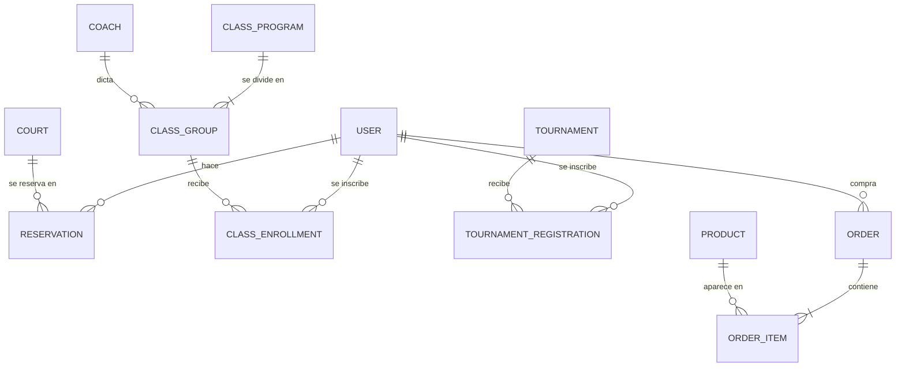

# PadelZone — Backend

API y base de datos del club de pádel PadelZone.

- **Base de datos:** PostgreSQL 16
- **ORM:** Prisma 7
- **Node.js:** 22.18 o superior (recomendado: la versión LTS más reciente)

## Puesta en marcha (primera vez)

Todos los comandos se ejecutan dentro de la carpeta `backend/`.

### 1. Levantar PostgreSQL

**Opción A — Docker (recomendada):** con Docker Desktop abierto:

```bash
docker compose up -d
```

**Opción B — PostgreSQL instalado en tu computador:** crea un usuario y una base de datos
(desde pgAdmin o `psql`) y pon esos datos en `DATABASE_URL` en el paso 2.

### 2. Variables de entorno

Copia `.env.example` como `.env`:

```bash
# Windows (PowerShell)
Copy-Item .env.example .env
# Mac / Linux
cp .env.example .env
```

Si usas Docker con la configuración por defecto, no tienes que cambiar nada.
Cambia `SEED_ADMIN_PASSWORD` por una contraseña propia.

### 3. Instalar dependencias, crear las tablas y cargar los datos

```bash
npm install
npm run db:migrate
npm run db:seed
```

### 4. Comprobar que funcionó

```bash
npm run db:studio
```

Se abre en el navegador una interfaz visual para ver las tablas: deberías ver
5 canchas, 4 programas de clases con 12 grupos, 4 profesores, 3 torneos, 6 productos y 1 usuario administrador.

## Scripts

| Comando | Qué hace |
|---|---|
| `npm run db:migrate` | Aplica las migraciones pendientes. Si cambiaste `schema.prisma`, crea una migración nueva |
| `npm run db:seed` | Carga los datos iniciales (se puede ejecutar varias veces sin duplicar) |
| `npm run db:reset` | ⚠️ Borra **todos** los datos, recrea las tablas y ejecuta el seed |
| `npm run db:studio` | Interfaz visual de la base de datos |
| `npm run db:generate` | Regenera el cliente de Prisma (se hace solo tras `npm install` y `db:migrate`) |

## Modelo de datos



El detalle de cada tabla está en [`prisma/schema.prisma`](prisma/schema.prisma).

### Decisiones de diseño

- **Dinero en pesos enteros (`Int`)**: evita errores de redondeo con decimales.
- **Precios copiados** en `reservations.total_price` y `order_items.unit_price`: si un precio cambia, las reservas y compras antiguas no se alteran.
- **Cancelar no borra**: se cambia `status` a `CANCELLED` y queda el historial.
- **Restricciones CHECK** (en la migración `init`): la base de datos rechaza horas fuera de 7:00–23:00, precios negativos, cupos en cero, etc., aunque el backend tenga un error.
- **No hay tabla de carrito**: el carrito vive en el frontend; solo se guarda el pedido final.
- **No se guardan datos de tarjetas**: si se implementan pagos reales, se hará con una pasarela de pago.

### Pendiente de confirmar

- Inscripción a torneos individual o por parejas (`partner_name` es opcional por ahora).
- Imágenes: hoy están dentro del frontend; los campos `image_url` quedan vacíos hasta definir dónde se alojan.
- La regla "una cancha no puede tener dos reservas solapadas" se aplicará en el servicio de reservas, dentro de una transacción.

## Errores comunes

| Error | Causa y solución |
|---|---|
| `Can't reach database server at localhost:5432` | PostgreSQL no está encendido: `docker compose up -d` o inicia el servicio |
| `port is already allocated` al usar Docker | Ya tienes otro PostgreSQL en el puerto 5432: detenlo o cambia el puerto a `"5433:5432"` y en `DATABASE_URL` |
| `Environment variable not found: DATABASE_URL` | Falta el archivo `.env` (paso 2) |
| `Cannot find module '.../generated/prisma/client.ts'` | Ejecuta `npm run db:generate` |
| `Unknown file extension ".ts"` | Tu Node.js es antiguo: instala la versión LTS más reciente |
